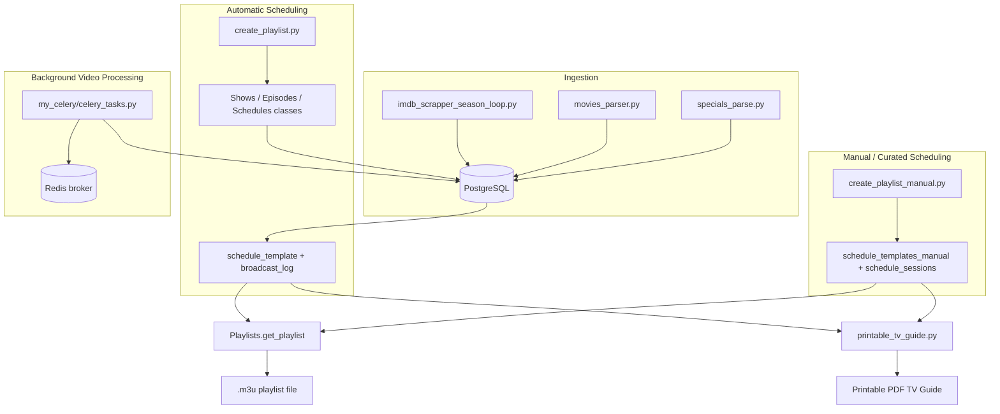
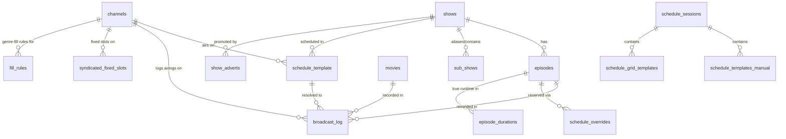

# Time Traveler

Time Traveler is a Python-based simulation engine for a retro (1950s-1980s) broadcast television network. It ingests real classic TV episodes, movies, specials, and commercials into a PostgreSQL database, generates period-accurate daily schedules for multiple simulated channels, produces playable `.m3u` playlists with era-matched commercial breaks, and renders a printable, duplex-imposed PDF TV Guide booklet styled after real vintage issues.

> **TODO:** No LICENSE file was found in this repository. License terms are undetermined.

## Table of Contents

- [Features](#features)
- [Architecture Overview](#architecture-overview)
- [Technology Stack](#technology-stack)
- [Project Structure](#project-structure)
- [Requirements](#requirements)
- [Installation](#installation)
- [Environment Variables](#environment-variables)
- [Running Locally](#running-locally)
- [Database](#database)
- [Frontend / API / Mobile](#frontend--api--mobile)
- [AI / Search / Machine Learning Components](#ai--search--machine-learning-components)
- [Security](#security)
- [Testing](#testing)
- [Build & Deployment](#build--deployment)
- [Troubleshooting](#troubleshooting)
- [Performance Considerations](#performance-considerations)
- [Contributing](#contributing)
- [License](#license)
- [Acknowledgements](#acknowledgements)

## Features

- **Automatic daily scheduling** per simulated channel (`playlists/create_playlist.py`), distinguishing network vs. syndicated channels, seeding from real historical schedule data where available, and falling back to decade-appropriate genre-biased random selection otherwise.
- **Sequential, non-repeating episode playback** — episodes air in `(season, episode)` order and are tracked per-channel in `broadcast_log` so reruns never repeat until the show's library is exhausted, at which point a replacement show is rotated in.
- **Multi-part episode continuity** — a multi-part story reserves the very next broadcast day's occurrence of its slot for the continuation via `schedule_overrides`, and is protected from being rotated out mid-arc.
- **Manual/curated scheduling path** (`playlists/create_playlist_manual.py`) for hand-built schedules (e.g. holiday programming) stored in `schedule_templates_manual`/`schedule_sessions`.
- **Holiday programming** blended into the normal schedule via the same override mechanism, rather than replacing an entire day.
- **`.m3u` playlist generation** (`playlists/classes/Playlists.py`) with era-matched commercial breaks selected (`playlists/classes/Commercials.py`) and inserted between and within programs, VLC-compatible playback options (start/stop time, aspect ratio, sharpening), and a sign-off sequence.
- **Printable TV Guide PDF** (`utils/printable_tv_guide.py`) — a 4-column booklet layout with correct saddle-stitch duplex-print imposition, period print advertisements, and multiple ad-layout styles (no-ad, full-column ad, two-column bottom-band ad, stacked ads) chosen to fit each page's actual content.
- **Content ingestion pipeline** — IMDb episode metadata scraping with season-by-season resumability (`imdb_scrapper_season_loop.py`), movie metadata scraping (`movies_parser.py`), and holiday special metadata (`specials_parse.py`).
- **Video processing utilities** (`utils/`) — black-frame/silence-based commercial break detection, black-and-white detection, letterbox removal, audio loudness normalization (EBU R128), and format conversion, all via `ffmpeg`/OpenCV.
- **Background video processing** (`my_celery/`) — Celery task definitions for black-and-white classification, commercial-break detection, and video reprocessing, backed by a Redis broker (see [Troubleshooting](#troubleshooting) for current wiring status).

## Architecture Overview

Two independent scheduling pipelines share a common PostgreSQL schema and a common set of data-access classes, but populate different template tables:



**Key design point:** the automatic pipeline's episode selection is deliberately DB-driven and stateful — `Episodes.get_next_episode()` always queries `schedule_template` joined against `broadcast_log` to find the lowest unaired `(season, episode)` for a show on a given channel, rather than tracking state in application memory. This lets the pipeline be re-run for any date without losing continuity.

> **Current state (verified against the live database):** `schedule_template` and `broadcast_log` are both empty. The automatic pipeline is implemented but has not actually been run/populated. All real scheduling right now happens through the manual/curated path — `schedule_templates_manual` currently holds one session (`christmas-2025`, `schedule_sessions`). A newer, UUID/session-keyed `schedule_grid_templates` table also exists and appears to be a parallel, in-progress scheduling mechanism not yet described by either pipeline above.

## Technology Stack

| Layer | Technology |
|---|---|
| Language | Python 3.11 |
| Database driver | `psycopg` 3 (`psycopg-binary`) |
| Database | PostgreSQL (version not pinned in this repository) |
| PDF rendering | ReportLab |
| Image processing | Pillow |
| Video/frame analysis | OpenCV (`opencv-python`) |
| Video/audio processing | `ffmpeg` (external binary, invoked via `subprocess`) |
| Web scraping | Playwright, BeautifulSoup4, Requests |
| Background task queue | Celery, with a Redis broker/result backend |
| Text-to-speech (standalone demo) | Coqui `TTS` |
| Sentence tokenization (guide descriptions) | `nltk` (`punkt_tab` model) |
| Config loading | `python-dotenv` |

> **TODO:** No PostgreSQL version, Redis version, or `ffmpeg` version requirement is declared anywhere in the repository.

## Project Structure

```text
time_traveler/
├── playlists/                    # Automatic + manual scheduling and playlist generation
│   ├── create_playlist.py        # Automatic per-channel schedule -> .m3u
│   ├── create_playlist_manual.py # Curated-session schedule -> .m3u
│   └── classes/                  # Shared DB-backed data access / business logic
│       ├── Channels.py           # Channel lookup (id, type: network/syndicated)
│       ├── Shows.py              # Show selection, genre bias, replacement rotation
│       ├── Episodes.py           # Episode sequencing, multi-part continuity, holiday episodes
│       ├── Movies.py             # Movie selection with broadcast-log tracking
│       ├── Specials.py           # Holiday special selection
│       ├── Commercials.py        # Commercial break selection/insertion
│       ├── Schedules.py          # Time-slot generation, historical-date mapping
│       ├── Playlists.py          # .m3u file writer (episodes/movies/specials + commercials)
│       └── Cartoons.py           # TODO: stub, no methods implemented
│
├── my_celery/                    # Background video-processing task definitions (Celery)
│   ├── celery_app.py             # Celery app + Redis broker configuration
│   ├── celery_tasks.py           # is_blackwhite / commercial_breaks / process_video tasks
│   ├── celery_ingestion.py       # Polls an ingestion_tasks table and dispatches tasks
│   └── classes/video_utils.py    # Black-and-white detection, commercial-break detection, etc.
│
├── utils/                        # Standalone video/audio/print tooling
│   ├── printable_tv_guide.py     # PDF TV Guide booklet renderer (ReportLab)
│   ├── concat_files.py / concat_commercials.py   # ffmpeg concatenation helpers
│   ├── find_silent_commercials.py / find_commercial_break_anomalies.py
│   ├── normalize_audio.py / get_loudest_point.py # Audio loudness tooling
│   ├── remove_black_bars.py      # Letterbox/pillarbox cropping
│   ├── avi_convert.py / chop_file.py / timeline_fix.py  # Format/organizational helpers
│   ├── playlist_playtime.py      # Sums total runtime of a generated .m3u
│   ├── speech_generator.py       # Standalone Coqui TTS demo (unrelated to main pipeline)
│   └── queries.txt               # Ad hoc SQL snippets used during development
│
├── advertising/                  # Static print assets used by the TV Guide renderer
│   ├── images/                   # Period print advertisement images
│   ├── logos/                    # Network/channel logo thumbnails
│   ├── shows/                    # Show-tie-in promotional images
│   ├── specials/                 # Special-event promotional images
│   └── fonts/                    # Fonts used when compositing ad images
│
├── imdb_scrapper_season_loop.py  # Episode ingestion: scrape + video processing pipeline
├── movies_parser.py              # Movie metadata scraping (Playwright-based)
├── specials_parse.py             # Holiday special metadata scraping
├── current_schedule.py           # Parses generated .m3u8 files into an HTML guide view
├── tv-guide.py                   # Generates an HTML guide directly from schedule_template
├── commercial_break_playlist.py  # Builds a standalone commercial playlist
├── requirements.txt              # Full pip-freeze style dependency list
└── .env                          # Local environment configuration (not committed with real values)
```

## Requirements

- Python 3.11
- A reachable PostgreSQL server with the schema described in [Database](#database)
- `ffmpeg` available on `PATH` (required by most of `utils/` and the ingestion pipeline)
- A Redis server, only if running the `my_celery/` background task subsystem
- The `advertising/` asset directories populated with print-ad/logo/font images for `printable_tv_guide.py`
- A network-accessible media share matching the `LOCAL_PATH` environment variable, containing the actual video/commercial/image files referenced by generated playlists (not stored in this repository)

## Installation

```bash
git clone git@github.com:flrogerw/time_traveler.git
cd time_traveler

python3.11 -m venv .venv
source .venv/bin/activate

pip install -r requirements.txt

python -m playwright install   # required for movies_parser.py's Playwright-based scraping

python -c "import nltk; nltk.download('punkt_tab')"   # required by utils/printable_tv_guide.py
```

> **TODO:** `requirements.txt` is an unpruned `pip freeze` (166 packages) that includes a heavy ML/TTS stack (`torch`, `spacy`, `TTS`) used only by the standalone `utils/speech_generator.py` demo. A minimal-install path for just the scheduling/playlist/guide tooling is not defined in the repository.

## Environment Variables

Discovered by searching all `.py` files for `os.getenv(...)` calls.

| Variable | Required | Default | Description |
|---|---|---|---|
| `DATABASE` | Yes (for scripts that read it) | None | PostgreSQL database name. Used by `playlists/create_playlist.py`, `playlists/create_playlist_manual.py`, `utils/printable_tv_guide.py`. |
| `DB_NAME` | Yes (for scripts that read it) | None | PostgreSQL database name — same purpose as `DATABASE`, used by a different subset of scripts. **Both variables should be set to the same value** until the codebase is unified onto one name. |
| `DB_USER` | Yes | None | PostgreSQL username. |
| `DB_PASSWORD` | Yes | None | PostgreSQL password. |
| `DB_HOST` | Yes | None | PostgreSQL host. |
| `DB_PORT` | No | `5432` (hardcoded in most connection calls) | PostgreSQL port. Read from the environment in some scripts; hardcoded to `5432` in others. |
| `LOCAL_PATH` | Yes (for playlist generation) | None | Base path (typically a network share, e.g. `/mnt/nas_server/time_traveler`) where video/commercial/image assets referenced by generated `.m3u` playlists live. |
| `SHARPEN_RATIO` | Yes (for playlist generation) | None | VLC `sharpen-sigma` value written into generated `.m3u` entries. |
| `DIR_ROOT` | Yes (for `commercial_break_playlist.py`) | None | Base directory `commercial_break_playlist.py` reads/writes commercial-break playlist content under. |
| `DIR_ROOT_PI` | Yes (for `my_celery/celery_ingestion.py`) | None | Base directory the Celery ingestion loop reads source video from — distinct variable name because it points at the path as seen from the ingestion host (e.g. a Raspberry Pi), not the main workstation. |

> **TODO:** No `.env.example` file exists. The variables above were reconstructed from source code; there may be additional variables used by scripts not fully audited (e.g. `my_celery/` task modules).

## Running Locally

Generate an automatic schedule and playlist for one channel:

```bash
python -m playlists.create_playlist \
  --hostname TV-ABC-7 \
  --year 1971 \
  --sim-date 2026-10-22 \
  --start 19:00:00 \
  --duration 05:00:00
```

- `--hostname` must match a `channel_name` row in the `channels` table (format `TV-<NETWORK>-<CHANNEL_NUMBER>`, e.g. `TV-SYN-5`).
- `--year` selects which simulated broadcast year (1960-1989) to schedule against.
- `--sim-date` is a real calendar date mapped onto an equivalent weekday-of-month in `--year`, so a recurring run naturally advances through the target year's calendar; `--dow` can be passed explicitly to override the derived day-of-week.
- `--holiday` (one of `christmas`, `thanksgiving`, `easter`, `halloween`) blends holiday-tagged content into the relevant slots instead of the normal rotation.

Generate a playlist from a manually curated session:

```bash
python -m playlists.create_playlist_manual --session_name christmas-2025 --year 1971
```

Render a printable TV Guide PDF from the generated schedule:

```bash
cd utils

# From the automatic schedule (create_playlist.py's output), for a given day-of-week/year:
python printable_tv_guide.py --source current --dow 3 --year 1971 --filename tv_guide.pdf

# From a curated manual session (create_playlist_manual.py's output):
python printable_tv_guide.py --source manual --session christmas-2025 --dow 1 --year 1971 \
  --filename tv_guide_christmas.pdf
```

`--session` accepts either a `schedule_sessions.friendly_name` (as above) or a raw `session_id` UUID. Run `python printable_tv_guide.py --help` for the full option list.

## Database

No schema migration files exist in this repository. The table list, columns, and row counts below were
captured directly from the live PostgreSQL instance (27 tables total — more than the code alone reveals,
since several are read/written only from data, not from SQL embedded in the scripts).



Tables referenced in code:

| Table | Purpose |
|---|---|
| `channels` | Simulated channel definitions (`channel_id`, `channel_name`, `channel_type`: `network`/`syndicated`, `channel_number`). 7 rows. |
| `shows` | Show metadata: genre, duration options, network affiliation, syndication flag, air-date range. 343 rows. |
| `episodes` | Individual episodes: season/episode number, air date, multi-part flag, file reference, B&W/processed flags. 17,527 rows. |
| `movies` | Movie metadata and file references. 270 rows. |
| `specials` | Holiday special metadata and file references. 67 rows. |
| `commercials` | Curated commercial clip metadata (sponsor, era, exact-year flag). 529 rows. |
| `commercial_breaks` | Detected break points (`break_point`/`resume_point`) within episode/movie media files. 60,738 rows. |
| `commercials_processed` | Tracks which `media_id`s have already had commercial-break detection run (`has_breaks` flag), decoupled from `episodes.is_processed`. 17,927 rows. |
| `tmp_commercials` | Staging table mirroring `commercials` (note: fixes the `commercial_sponser` → `commercial_sponsor` column-name typo) — looks like an in-progress migration of the `commercials` table. 27 rows. |
| `episode_durations` | True runtime of an episode after subtracting commercial breaks. 17,350 rows. |
| `show_adverts` | Show-specific promotional ad assets used by the printable guide. 3 rows. |
| `sub_shows` | Maps a `show_id` to a list of `sub_show_ids` (anthology/umbrella shows containing linked sub-shows, e.g. NBC Mystery Movie → Columbo/McCloud/Banacek/McMillan & Wife). 2 rows. Now read by `Episodes.get_next_episode()`/`Shows.get_replacement_show()` — see the Architecture section. |
| `bumpers` | Network-branded interstitial clips, tagged to specific networks (`bumper_networks`) and an air-date. 1 row. |
| `schedule_template` | The automatically-generated recurring schedule (channel, time slot, show, days of week). **Currently empty** — the automatic pipeline has not been run against this database. |
| `broadcast_log` | Record of every episode/movie actually aired per channel/date, used to enforce sequential non-repeating playback. **Currently empty**, consistent with `schedule_template` being unused. |
| `seen_episodes` | Per-channel list of already-aired episode IDs. 424 rows. Overlaps in purpose with `broadcast_log`; likely an earlier or parallel tracking mechanism. |
| `schedule_overrides` | Date-specific overrides to the recurring template (used for multi-part continuations and holiday programming). Currently empty. |
| `time_slot_schedules` | Generated time-slot boundaries per channel/day prior to content assignment. 4,257 rows. |
| `schedule_templates_manual` / `schedule_sessions` | Human-curated schedules, grouped into named sessions. Currently 42 rows / 1 session (`christmas-2025`) — this is the path actually populated with real data today. |
| `schedule_grid_templates` | A newer, UUID/session-keyed scheduling table (`start_slot`/`duration_slots`, linked to `schedule_sessions`) not exercised by either documented pipeline's code paths — appears to be an in-progress third scheduling mechanism. 42 rows. |
| `syndicated_fixed_slots` | Fixed day-of-week/time/show slots per syndicated channel — a simpler, separate scheduling mechanism from the template-based pipelines. 15 rows. |
| `fill_rules` | Per-channel, per-time-window, per-day-of-week rules for which genre categories may fill a slot and at what weight — formalizes the "decade-appropriate genre-biased random selection" behavior as data. 42 rows. |
| `schedules` | Historical real-world broadcast records used to seed network-channel reruns. 3,911 rows. |
| `ingestion_tasks` | Text-status task queue (`pending`/`complete`/`error`) polled by `my_celery/celery_ingestion.py`. 3,195 rows (3,190 complete, 5 errored). |
| `video_tasks` | A typed-enum (`task_status`) task queue, functionally similar to `ingestion_tasks` but with a proper Postgres enum instead of free text — appears to be a newer/parallel queue. 587 rows, all `complete`. |
| `unwanted_frames` | Flags bad/unwanted video frames by `frame_image_path`/`video_id`, with a vector `embedding` column (`pgvector`) — the only embedding/ML-search-backed table in the schema. 1 row. |

> **Note:** several of these tables (`fill_rules`, `schedule_grid_templates`, `syndicated_fixed_slots`, `bumpers`, `seen_episodes`, `commercials_processed`, `tmp_commercials`, `video_tasks`, `unwanted_frames`) are not referenced anywhere in the current Python source — they were only discovered by inspecting the live database directly. Treat them as evidence of schema evolution/migration in progress rather than dead weight to remove. (`sub_shows` was in this list until it was wired up for umbrella/rotation scheduling — see Architecture.)

## Frontend / API / Mobile

This repository contains no web frontend, REST/GraphQL API, or mobile application. `Flask` appears in `requirements.txt` but is not imported or used anywhere in the codebase — it is presumed to be an unused/transitive dependency.

`current_schedule.py` and `tv-guide.py` each generate a static HTML view of a schedule (from parsed `.m3u8` files and from `schedule_template` directly, respectively), but neither runs a web server.

## AI / Search / Machine Learning Components

There is no embedding-based search, vector database, or ONNX inference pipeline in this repository. The only machine-learning-adjacent components are:

- **OpenCV-based black-and-white classification** (`my_celery/classes/video_utils.py`) — analyzes video frames to determine if content should be tagged black-and-white.
- **Coqui `TTS`** (`utils/speech_generator.py`) — a standalone voice-cloning/text-to-speech demo script, unrelated to the scheduling/playlist pipeline.
- **spaCy** is declared in `requirements.txt` but no direct `import spacy` usage was found outside of transitive imports from other packages.
- **`unwanted_frames` table** (discovered live in the database, not referenced in current source) has a `pgvector` `embedding` column alongside `frame_image_path`/`video_id` — evidence of a similarity-search-based unwanted-frame-detection feature that is either planned or was removed from the codebase but left its data behind.

## Background Video Processing (Celery)

`my_celery/` defines a standalone Celery-based subsystem for offloading per-episode video work. It is **not invoked by any other part of this codebase** (confirmed via full-repo search) — it must be run and fed independently of the scheduling/playlist/guide pipelines.

**Tasks** (`my_celery/celery_tasks.py`), all routed to a single `video_queue` (`my_celery/celery_app.py`):

| Task | What it does |
|---|---|
| `is_blackwhite(input_file, episode_id, dev_mode=True)` | Runs `IsBlackWhite.is_video_black_and_white_opencv()` (OpenCV frame analysis) and, outside `dev_mode`, writes the result back via `IsBlackWhite.insert_bw(episode_id, is_bw)`. |
| `commercial_breaks(input_file, episode_id, start_point, end_point, dev_mode=True)` | Runs ffmpeg `blackdetect` and `silencedetect` over the file, merges the two candidate-break lists, filters out any that fall at the very start/end of the episode, and (outside `dev_mode`) inserts the result via `CommercialBreaks.insert_commercial_break()`. |
| `process_video(task_id, episode)` | Writes ID3-style metadata (title, artist, comment, year) into the episode's video file via `VideoReProcess.reprocess()`, cleaning up a temp file afterward. |

**Ingestion loop** (`my_celery/celery_ingestion.py`, run via `python -m my_celery.celery_ingestion`): polls the `ingestion_tasks` table every `poll_interval` seconds (2s when run as `__main__`), atomically claiming `pending` rows with `UPDATE ... WHERE task_id IN (SELECT ... FOR UPDATE SKIP LOCKED)` so multiple ingestion processes can't double-claim a row. Each claimed row's `episode_data` (JSON) is submitted to `process_video.apply_async(...)`; the loop blocks on `task.get()` for every submitted batch and writes the outcome back to `ingestion_tasks.status`/`.message` (`complete` or `error`).

**Queue configuration** (`my_celery/celery_app.py`): broker and result backend are both hardcoded to `redis://192.168.1.201:6379` (databases `0` and `1` respectively) rather than read from the environment; `task_acks_late=True` and `task_reject_on_worker_lost=True` are set so an in-flight job is requeued if its worker dies, with a 2-hour hard time limit (`task_time_limit`) and a ~1h56m soft limit.

> **TODO:** No `Procfile`, systemd unit, or documented `celery worker` invocation exists in the repository. Given `celery_tasks.py` imports `from celery_app import celery_app` and `from classes.video_utils import ...` (unqualified — expects `my_celery/` itself to be the working directory / on `sys.path`), while `celery_ingestion.py` imports `from my_celery.celery_tasks import process_video` (package-qualified — expects the repository root on the path), a worker most likely needs to be started from inside `my_celery/` (e.g. `cd my_celery && celery -A celery_app worker -Q video_queue`) while the ingestion loop is run from the repository root (`python -m my_celery.celery_ingestion`). This is inferred from the import styles, not from a documented run procedure.

## Security

- Most scripts load database and file-share credentials from environment variables via `python-dotenv`; `.env` is excluded from version control via `.gitignore`.
- **Exception:** `specials_parse.py`, `movies_parser.py`, and `imdb_scrapper_season_loop.py` do not use `dotenv`/`os.getenv` at all — they hardcode the PostgreSQL connection, including a plaintext password, directly in source. This is a real credential-exposure issue since these files are tracked in version control.
- There is no authentication layer anywhere in the system — all scripts are run locally/manually against a trusted database and file share.
- `my_celery/celery_app.py` hardcodes a Redis broker/backend URL (a private LAN IP) directly in source rather than via environment configuration.

## Testing

> **TODO:** No test files, test framework configuration, or CI workflow were found in this repository. There is no documented process for verifying changes beyond manually running the relevant script against a live database.

## Build & Deployment

> **TODO:** No Dockerfile, docker-compose configuration, or CI/CD workflow (e.g. GitHub Actions) exists in this repository. All components are run directly as Python scripts in a local virtual environment against a manually-provisioned PostgreSQL server (and, for `my_celery/`, a Redis server).

## Troubleshooting

- **`ModuleNotFoundError: No module named 'playlists'`** when running a script directly — run scripts as modules from the repository root (e.g. `python -m playlists.create_playlist ...`) rather than invoking the file path directly, since the codebase uses absolute package imports (`from playlists.classes.X import X`).
- **`LookupError: Resource 'punkt_tab' not found'`** when running `utils/printable_tv_guide.py` — run `python -c "import nltk; nltk.download('punkt_tab')"` once per environment.
- **`FileNotFoundError` for `advertising/...` paths** when running `utils/printable_tv_guide.py` — the script's asset paths are relative to the `utils/` directory; run it with `utils/` as the working directory (`cd utils && python printable_tv_guide.py`).
- **`my_celery/` tasks never execute** — no other part of the codebase enqueues tasks against this Celery app, and its Redis broker points to a specific LAN host; treat it as a separate, not-yet-integrated subsystem rather than part of the main scheduling/playlist flow.
- **A show appears to air on more than one channel at the same time** — `Shows.get_available_show_id()` enforces exclusivity per `replication_year` across all channels; if this is observed, check for stale `schedule_template` rows from an earlier data set that predates this constraint.

## Performance Considerations

- `Shows.process_scheduled_shows()` looks back up to `SCHEDULE_RECURSION` (3) prior years to backfill gaps in a network channel's historical schedule, which adds repeated-query overhead for channels with sparse historical data.
- `utils/printable_tv_guide.py` performs its own PDF-page-fitting calculations per page using a throwaway in-memory canvas purely for text measurement; generating a very large guide (many weeks/channels at once) has not been benchmarked.
- Video-processing utilities in `utils/` shell out to `ffmpeg` per file with no parallelism; batch operations over large libraries are expected to be I/O- and CPU-bound and are not optimized for concurrency.

## Contributing

> **TODO:** No `CONTRIBUTING.md`, issue templates, or pull-request guidelines exist in this repository.

## License

> **TODO:** No `LICENSE` file was found in this repository. Do not assume any particular license applies.

## Acknowledgements

- [ReportLab](https://www.reportlab.com/) for PDF generation.
- [OpenCV](https://opencv.org/) and [Pillow](https://python-pillow.org/) for image/video analysis.
- [Playwright](https://playwright.dev/) and [BeautifulSoup](https://www.crummy.com/software/BeautifulSoup/) for content metadata scraping.
- [Coqui TTS](https://github.com/coqui-ai/TTS) for the standalone speech-synthesis demo.
